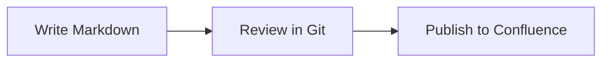
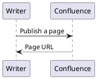

# Mermaid & PlantUML

Keep diagram source beside your writing. Markdown Confluence renders Mermaid and optional PlantUML diagrams and uploads the resulting images with your pages.

## Mermaid

Write a fenced Mermaid block:

````markdown

````

The CLI/container use the Puppeteer renderer; Obsidian uses the Electron renderer. Library consumers add `MermaidRendererPlugin` and their chosen renderer to the publisher.

The Puppeteer protocol timeout defaults to 180,000 milliseconds. For a large diagram, increase the positive integer setting in `.markdown-confluence.json`:

```json
{
  "mermaidProtocolTimeout": 600000
}
```

The environment equivalent is `CONFLUENCE_MERMAID_PROTOCOL_TIMEOUT`. A longer timeout gives rendering more time; invalid Mermaid syntax still needs to be corrected.

## PlantUML

PlantUML is disabled by default. Enable it and configure a server you trust to receive the diagram source. A local server is one option:

```sh
docker run -d --name plantuml -p 8080:8080 plantuml/plantuml-server:jetty
```

Then configure the publisher:

```json
{
  "plantuml": {
    "enabled": true,
    "serverUrl": "http://localhost:8080"
  }
}
```

Use the address reachable from the publishing process. In a container, `localhost` refers to that container rather than your host machine.

````markdown

````

Fences named `plantuml`, `puml`, or `uml` are supported, as are Obsidian-style embeds such as `![[diagram.puml]]`. The published diagram is followed by a collapsible source section. PNG is the default; library consumers can choose SVG through the renderer.

When PlantUML is disabled, the fenced source remains a code block instead of being sent to a rendering server.

## Images and attachments

Ordinary Markdown images, reference-style images and Obsidian embeds use the shared media pipeline. Version 7 preserves paths containing balanced parentheses, escaped characters and titles, with live checks covering spaces, Unicode, PNG/SVG and unchanged attachment versions. See [what changed](./release-notes.md).

## Mermaid output controls


```json
{
  "mermaid": {
    "format": "png",
    "scale": 2,
    "theme": "neutral",
    "themeVariables": { "primaryColor": "#ddebff" }
  }
}
```

CLI options: `--mermaidFormat png|svg`, `--mermaidScale 1..4`, `--mermaidTheme neutral`. Obsidian exposes output, scale and theme variables alongside its existing theme selector. PNG remains the default; scale controls raster resolution. SVG uploads use the correct SVG MIME type. Rendering options do not relax Mermaid's strict security mode. Different output formats get distinct attachment filenames.


Supported themes are `default`, `neutral`, `dark`, `forest` and `base`. `themeVariables` is a JSON object of string values.

## More diagram types with Kroki

Version 7 also supports opt-in `kroki-graphviz`, `kroki-ditaa` and other `kroki-<type>` fences through a trusted Kroki server. Choose PNG or SVG; diagram source is sent to that server. Mermaid and PlantUML fences keep their existing renderers. Follow the [Kroki setup guide](/docs/kroki).

## Sources

- [Mermaid and PlantUML migration notes](https://github.com/markdown-confluence/markdown-confluence/blob/9392b954dc50d48d1ea072d555cf7029d562e00f/documentation/MIGRATING_TO_6.md#diagrams)
- [CLI diagram configuration](https://github.com/markdown-confluence/markdown-confluence/blob/9392b954dc50d48d1ea072d555cf7029d562e00f/packages/cli/README.md#plantuml-support)
- [Current-source image and diagram verification](https://github.com/markdown-confluence/markdown-confluence/blob/9392b954dc50d48d1ea072d555cf7029d562e00f/documentation/CLOUD_API_MIGRATION.md#feature-acceptance)
